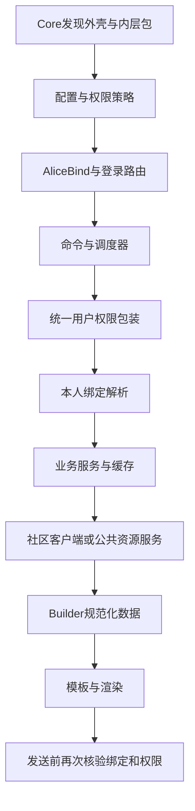
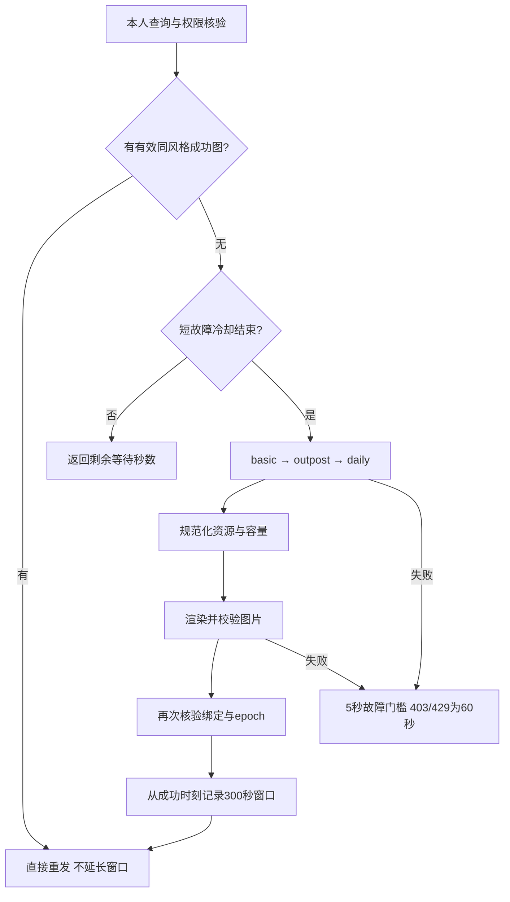

# AliceUID 开发文档

适用版本：**1.0.14**。本文依据本目录实际源码编写，涵盖插件生命周期、模块与命令、客户端及HTTP接口、字段和资源映射、缓存与权限，以及测试发布流程。社区端点是当前适配代码使用的协议，不代表上游提供永久稳定的接口承诺。

用户使用说明见 [README.md](README.md)，版本变化见 [CHANGELOG.md](CHANGELOG.md)。路径以本文件所在的插件外壳为基准；`AliceUID/nikke_api/client.py` 指外壳下的内层代码。

## 1. 系统与目录

```text
AliceUID/                       ← 可安装外壳
├─ __init__.py / __nest__.py     ← Core嵌套插件发现入口
├─ AliceUID/                    ← 内层代码
│  ├─ __init__.py               ← Plugins、SV、Web路由、调度与权限注册
│  ├─ nikke_*/                  ← 业务模块
│  ├─ templates/                ← Jinja HTML/CSS
│  └─ data/                     ← 随包静态表兜底
├─ assets/                      ← 登录页及资源小图
├─ card_bg/                     ← 六张原始背景
├─ formts/                      ← 字体；拼写是现有目录契约
├─ pyproject.toml / requirements.txt
└─ README.md / CHANGELOG.md / DEVELOPMENT.md
```

版本工作区额外包含 `tests_alice/`、`tools_alice/`、`docs/`、`handoff/`、`.references/`、`.runtime/`、`dist/`。这些属于开发与交付环境，不应直接放入Core插件扫描目录。生产与开发数据路径的区别见第9节。

### 注册顺序

[内层入口](AliceUID/__init__.py) 在正常模式下执行：

1. 注册 `Plugins(name="AliceUID", force_prefix=["nk"], allow_empty_prefix=False)`。
2. 在任何SV与StringConfig初始化前，通过Core PluginConfigStore完成旧前缀的一次性迁移，通过Plugins.set同步内存前缀，再调用Core的get_plugin_available_prefix读取帮助文案快照；随后建立插件配置与四名单策略。
3. 导入 `AliceBind` 模型并尝试挂载Core后台管理；不兼容的管理界面不会阻止普通登录。
4. 导入各模块命令和登录Web路由；部分模块在 `setup()` 中注册。
5. 启用日历、数据库命令及周检、社区调度、图鉴命令，绑定会战发送前核验。
6. 调用 `guard_plugin_triggers()` 保留普通命令的统一用户权限检查。前缀完全由Core原生SV注册生成，不替换触发器，不手动刷新候选索引。AI入口在to_ai注册前已加专用查询检查。

`ALICEUID_STANDALONE=1` 只供测试/离线渲染，跳过上述Core注册；生产不能设置它。



### 模块职责

| 模块 | 主要责任与入口 |
|---|---|
| `nikke_config` | `config_default.py` 默认配置；`config.py` 路径与ValidatedStringConfig |
| `nikke_commands` | 旧前缀迁移、Core前缀启动快照、command_prefix提示映射 |
| `nikke_ai` | 四类to_ai查询入口的权限检查、图片结果核验后的最小数据摘要 |
| `nikke_message` | 默认开启的实验性转发、标题首节点、完整单图JPG、NapCat消息ID回执与普通消息回退 |
| `nikke_permissions` | 四名单校验、Core Trigger包装、群管理命令；`policy.py/config.py/access.py` |
| `nikke_user` | `AliceBind`、加密存储、加载本人客户端、绑定锁、受控后台解绑、主动面板刷新 |
| `nikke_login` | 选服命令、一次性内存会话、密码/邮箱浏览器流程、验证码与HTTP路由 |
| `nikke_api` | Credentials、CookieCipher、NikkeClient、StaticData解析、CDN路径生成 |
| `nikke_resource` | 静态表、图片缓存、皮肤映射、徽章、收藏品元数据、卡片资源准备 |
| `nikke_database` | 公共数据增量队列、预算与冷却、维护命令、周检调度 |
| `nikke_profile` | 个人资料取数与缓存、720 CSS宽信息卡Builder及绘制 |
| `nikke_character` | 角色匹配、本人持有校验、练度详情、装备词条、别名与持久面板缓存 |
| `nikke_roster` | 完整十列图鉴、AccountReads节流、可见内容指纹和发送后续期 |
| `nikke_union` | 本人联盟确认、赛季路由、成员/出刀规范化、当前与历史快照 |
| `nikke_status` | 资源与BOSS状态；成功图片窗口、容量估算、状态图缓存与命令 |
| `nikke_uid` | 明确类型的UID/分享标识登记；本地解析，不加载私人查询客户端 |
| `nikke_community` | 本人授权、任务协议、持久预算/幂等账本、立即执行与30分钟调度 |
| `nikke_calendar` | 匿名浏览器截取官网日历、缓存与过期提示 |
| `nikke_help` | 同源的权限感知帮助Context，图片与文字输出 |
| `nikke_render` | 模板主题、语言、字体、照片毛玻璃、布局注册、外置/原生渲染 |
| `nikke_proxy` | 浏览器代理适配；当前配置不等于已实现代理池或每用户独立IP |
| `templates` | 正式页面模板及 `card_badges.html` 等共享片段 |

## 2. 命令到业务的调用关系

| 用户入口 | 处理/服务 | 数据来源 | 输出 |
|---|---|---|---|
| 登录/登陆、绑定账号 + 区服 | `nikke_login.commands.nikke_login_cmd` | 显式区服、SessionStore | 一次性本人登录链接 |
| 重新登录/重新登陆 | `nikke_relogin_cmd` | 原绑定revision及区服 | 同账号同区服更新凭据 |
| 我的账号、解绑 | `nikke_login.commands` → `nikke_user` | AliceBind | 摘要/解除与缓存撤销 |
| 信息/名片/个人资料 | `nikke_profile.commands._profile_data` | basic、outpost、characters、saved_role、player_info | `build_profile_context` → `draw_profile` |
| 角色练度/面板 | `nikke_character.commands` → `CharacterQueryService.query` | 本人角色列表、匹配name_code的详情、静态装备表 | compact角色卡 |
| 卡片 | `RosterService.prepare` | basic与本人characters、资源映射 | 完整JPEG图鉴 |
| 刷新信息/刷新面板 | `nikke_user.panel_refresh` | 本人资料及全部角色/皮肤详情 | 原子替换持久快照，手动完成后发送信息图 |
| 出刀及速查/详情/缺刀/尾刀 | `nikke_union.commands` → `UnionService.query` | 本人联盟、成员、当前或历史赛季 | 会战卡片 |
| 会战血量 | `nikke_status.commands` → `UnionService.query_bosses` | 同一已验证联盟快照的level_payload | 血量状态卡 |
| 资源查询 | `ResourceStatusService.prepare_image` | basic→outpost→daily | 成功图片缓存窗口与资源卡 |
| 日历 | `nikke_calendar.commands/service` | 匿名官网默认页面 | 带时间/来源的截图 |
| 角色别名查询/新增/注册 | `nikke_character.alias_commands/aliases` | 静态角色与本地别名字典 | 查询卡/管理员写入 |
| 绑定UID/我的UID/解绑UID | `nikke_uid.commands` → `UIDStore` | 本人提交的明确类型标识 | 本地登记，不证明账号归属 |
| 签到查询[页码]（Bot主） | `runtime.report_group → group_report_text` | 本地绑定、group_seen与独立签到确认 | 本群已知范围文字分页 |
| 自动社区/签到/开启全量签到 | `CommunityCommands` → `CommunityService` | 本人授权及社区账本 | 本轮结果或状态 |
| 数据库更新/状态/帮助 | `DatabaseCommands` → `DatabaseService` | 公共表与固定美术源 | 后台队列与摘要 |
| 帮助/帮助文字 | `build_help_context → draw_help/help_text` | Core用户权限、当前绑定摘要 | 图片失败可回退文字 |

裸命令、空格与别名是否匹配由Core Trigger契约决定。登录与登陆注册到同一个 `on_command`；重新登录/重新登陆是 `on_fullmatch`，不额外接受换服参数。新增命令后必须同步帮助并重新执行统一Trigger包装。

## 3. 身份、区服与持有关系

### 标识不要混用

| 标识 | 含义/来源 | 使用规则 |
|---|---|---|
| `user_id + bot_id` | Core确认的消息发送者 | 选择绑定、权限与个人缓存；不用@对象替代 |
| `game_id` | 游戏产品编号 | 五区使用29080；不是每个玩家唯一值 |
| `area_id` | 区服数字 | 与客户端region及接口响应一起核验 |
| `intl_open_id` | Cookie对应的社区账号身份 | 本人私人接口参数；不能从任意输入UID构造客户端 |
| `uid / role_id` | 游戏角色UID | 主要从GetSavedRoleInfo的role_info.role_id读取，需game_id/area_id匹配 |
| `name_code` | 角色逻辑编码 | 静态名字、本人角色及详情匹配的主键 |
| `resource_id` | 角色美术资源编号 | 静态角色表映射，不能直接把name_code当文件号 |
| `costume_id / costume_tid` | 本人接口报告的皮肤ID | 需映射到本角色costumes中的costume_index |
| `skin_index` | 美术变体序号 | 用于SI/MI/full路径，不独立证明拥有 |
| `binding revision` | `sha256(cookie_enc)` | 旧会话、在途任务与缓存隔离；不日志输出密文本体 |

| 区服 | area_id | region.name |
|---|---:|---|
| 日服 | 81 | japan |
| 北美服 | 82 | na |
| 韩服 | 83 | korea |
| 国际服 | 84 | global |
| 东南亚服 | 85 | sea |

代码定义了港澳台91/29157，但它不在当前登录REGIONS中；不能据此宣传港澳台已支持。登录选服函数向detect_region只传一个所选候选，不跨区自动探测。

### 角色与皮肤映射

[StaticData](AliceUID/nikke_api/parser.py) 加载静态表。角色查询先按官方名称、简繁归一/别名等规则解析；歧义返回候选，不根据持有角色偷偷猜选。之后检查该name_code确实存在于本人characters，再请求/读取对应详情。

[resolve_skin](AliceUID/nikke_resource/skins.py) 优先读取角色列表 `costume_id`；仅在缺失时考虑匹配角色详情的 `costume_tid`。基础皮肤0为显式报告；未知、映射不到或重复映射降级为基础图并保留notice。双方报告冲突时列表优先；详情name_code不匹配时拒绝借用其皮肤。

```python
# 静态映射示例；owned_row应来自发命令者本人接口。
selection = resolve_skin(owned_row, static)
rid = static.resource_id(owned_row["name_code"])
url = character_resource_url("portraits", rid, selection.skin_index)
# 生产卡片通过ResourceService/ImageCache准备资源，不让模板自行联网。
```

头像/完整图库中存在文件、静态costumes列表或分享参数都不代表账号拥有。会战角色ID需要时通过 `character_id_map.json` 辅助映射；不能把其他成员详情当成本人私人练度。

## 4. 私人社区客户端接口

代码：[nikke_api/client.py](AliceUID/nikke_api/client.py)。基地址为 `https://api.blablalink.com`，数据读取默认语言 `zh-TW`。调用方使用 `load_client(ev.user_id, ev.bot_id)` 从本人绑定加载，结束后关闭client。

`_request` 串行访问该客户端实例、禁止跳转；HTTP401与业务401/300001归入NikkeLoginRequired，403/429按拒绝/限流报错，业务code=0解包，其他code为NikkeApiError。它不会通用自动重试；业务服务另行管理节流、缓存和允许的一次性补读。

下表G前缀为 `/api/game/proxy/Game/`；账号参数A为 `{intl_open_id, nikke_area_id}`，必须从已核验的本人客户端取得。

| 客户端方法 | HTTP/端点 | 请求 | 返回与用途 |
|---|---|---|---|
| `check_login()` | GET `/api/user/CheckLogin` | 当前Cookie与公共头 | code=0且msg=ok时True |
| `get_characters()` | POST G+`GetUserCharacters` | A | `data.characters`，本人持有列表 |
| `get_character_details(codes)` | POST G+`GetUserCharacterDetails` | A + `name_codes`列表 | `data`；服务匹配character_details与state_effects |
| `get_basic_info()` | POST G+`GetUserProfileBasicInfo` | A | `data.basic_info`；身份、进度、货币等 |
| `get_outpost_info()` | POST G+`GetUserProfileOutpostInfo` | A | `data.outpost_info`；前哨与同步等级 |
| `get_daily_progress()` | POST G+`GetUserDailyContentsProgress` | A | `data`；daily_progress中的保管箱容量 |
| `get_saved_role_info()` | POST G+`GetSavedRoleInfo` | 空对象 | `data.role_info`；匹配后使用role_id |
| `get_game_player_info()` | POST `/api/ugc/direct/standalonesite/User/GetUserGamePlayerInfo` | 空对象 | `data`；游戏概览/联盟名等 |
| `get_union_raid_data()` | POST G+`GetUnionRaidData` | A | 原始出刀data；实际会战服务负责更完整的联盟确认 |
| `get_union_raid_level()` | POST G+`GetUnionRaidLevelInfo` | A | 原始血量data |

### 会战服务的额外端点

[UnionService](AliceUID/nikke_union/service.py) 直接通过client._request调用以下POST端点，不能只用上表两个raid方法取代它的身份/赛季逻辑。

| G后的端点 | 参数 | 处理 |
|---|---|---|
| GetMyGuildInfo | 空对象 | 确认本人当前guild_id和guild_name |
| GetGuildMembers | guild_id、字符串nikke_area_id | 规范化成员名单，无法获取时不凭空补0刀 |
| GetUnionRaidData / GetUnionRaidLevelInfo | A，已确认时附guild_id | 当前/结算中的赛季快照 |
| GetUnionRaidDataOfGuildSeason / GetUnionRaidLevelDataOfGuildSeason | 数字area_id、guild_id、字符串season_id | 历史赛季；必须先确认本人联盟 |

公开 `/raid/raid_list.json` 经CDN映射后确定赛季与接口类型。只有已结算、通过历史接口取到非空出刀和血量的快照才能长期复用；仍先核对赛季、当前联盟及名单。没有赛季名单时，可将当前完整名单明确标为历史对照；新入会者无记录不能被认定为上期实际漏刀。

### 社区任务端点

代码：[api.py](AliceUID/nikke_community/api.py)、[service.py](AliceUID/nikke_community/service.py)。调用必须经过CommunityService的本人授权、绑定revision、账本与请求预算，不能直接重放写请求。

| HTTP/路径后缀 | 请求关键字段 | 用途 |
|---|---|---|
| GET `/api/lip/proxy/lipass/Points/GetTaskListWithStatusV2` | get_top=false、intl_game_id | 读取本周期任务状态 |
| POST `/api/lip/proxy/lipass/Points/DailyCheckIn` | task_id | 签到，账本去重 |
| POST `/api/ugc/direct/standalonesite/Dynamics/GetPostList` | plate_id=38、plate_unique_id=outpost、limit等 | 受预算约束的帖子候选 |
| POST `/api/ugc/direct/standalonesite/Dynamics/GetPost` | post_uuid | 已授权浏览 |
| POST `/api/ugc/proxy/standalonesite/Dynamics/PostStar` | post_uuid、type=1、like_type=1 | 已授权且确认未赞的帖子点赞 |
| GET `/api/lip/proxy/lipass/Points/GetUserTotalPoints` | 无额外业务参数 | 读取可确认的积分余额 |

已知当期已签到时不继续重复签到、浏览/点赞或积分读取。未知任务不猜测操作；跨北京时间08:00终止当前轮次，由下一轮重新识别。定时任务借用Core scheduler，每天北京时间配置时刻执行（默认08:33），配置保存后重排同一任务，单实例、合并调度。

1.0.05的 `Policy(min_interval,daily_requests,max_interval,switch_min,switch_max)` 默认 `(5,30,15,10,120)`；`pacing.parse_range()`解析后台范围字符串，`CommunityService.uniform`可注入测试随机源。每次逻辑请求抽取均匀分布间隔，只在真正reserve发送时推进全局next_at；等待循环不重复抽样。每轮抽取一个换号等待，pacing表增加last_account（账号哈希）与switch_at；上一账号最后HTTP响应成功/失败后都推进switch_at。下一账号满足max(next_at,switch_at)，同账号只满足next_at，已跳过账号不消耗等待或预算。SQLite迁移保留旧next_at，长等待扩展执行租约；600秒仍为实际请求执行的基础租约。

返回结果新增 `counts={signin,browse,like}` 与 `signin_confirmed`。只在HTTP成功确认后累计对应操作；跨08响应不得用counts冒认新周期签到。`messages.result_message()`生成紧凑文本，金币缺失不写成0，部分完成与异常暂停同时显示。signin_confirmations仍独立于last_day保存。

## 5. 登录Web与后台接口

代码：[routes.py](AliceUID/nikke_login/routes.py)。所有会话型API只面向Bot生成的当前登录会话；token是一次性能力标识，不是匿名查询任意账号的入口。每次检查会话、所属用户访问权限及旧绑定状态。

| 方法/路由 | 输入字段 | 功能 |
|---|---|---|
| GET `/nikke/assets/{filename}` | 安全的资源文件名 | 登录素材，拒绝路径穿越 |
| GET `/nikke/i/{token}` | 有效会话token | 输出登录页 |
| POST `/nikke/api/login` | token、account、password、可选generation | 启动密码登录流程 |
| POST `/nikke/api/mode` | token、mode、可选generation | 切换密码/邮箱等会话模式 |
| POST `/nikke/api/email/send` | token、account、可选generation | 本人触发邮箱验证码发送 |
| POST `/nikke/api/email/verify` | token、code、generation | 提交邮箱验证码 |
| POST `/nikke/api/status` | token | 轮询状态与当前挑战 |
| POST `/nikke/api/captcha` | token、dx、challenge_id、可选generation | 提交当前挑战的位移 |
| POST `/nikke/api/captcha/refresh` | token、challenge_id、generation | 主动刷新挑战 |
| POST `/nikke/api/cookie` | token、cookie | 会话允许时导入凭据 |

具体错误JSON及状态字段以路由函数为准，不依赖人类提示文字判断成功。前端须跟踪generation与challenge_id，过期挑战不能提交给新会话。

[SessionStore](AliceUID/nikke_login/session.py) 只在内存持有会话。创建默认TTL600秒；进行中的登录/验证码流程有独立360秒上限；成功结果保留300秒供状态读取。取消会递增generation、唤醒等待、取消任务并清理验证码/挑战内容。重启不恢复旧登录链接。

保存绑定经过 [save_login](AliceUID/nikke_user/service.py)：先持有本人绑定锁，核验已有绑定、revision和账号/区服；Cookie加密后落库，再重新读取确认提交结果。重新登录使用比较并交换更新，不通过删行重建账号，也不静默换人换服。

### 登录链接消息发送

`nikke_login.commands._send_login_link(bot,text,url,*,ev=None)`由首次登录和重新登录共用，显式传入当前Event；省略时可读取bot.ev。LoginQRCode控制二维码生成，构造显式text/image消息段，避免URL字符串被node构造器误识别为图片。LoginForward开启时以 `bot.send(MessageSegment.node(content))` 发送，不附外层at_sender。

OneBot私聊与Core非「允许」策略直接普通发送。共享边界依连接区分：NapCat适配器请求消息ID回执并在未确认时回退一次；其它适配器沿用异常/False回退、None/空列表不重发的兼容规则。二维码与原链接复用，普通群消息可at，取消向上传播。

发送仍经过原_LiveAccessBot.send权限包装。异常日志只记录类型，不记录URL、会话token或原始错误；不创建新的登录会话来重试发送。参考[鸣潮固定源码](https://github.com/Loping151/XutheringWavesUID/blob/4c1727580c613ef3034a391dc3156a1570cd5260/XutheringWavesUID/wutheringwaves_login/login.py)和[Core固定发送实现](https://github.com/Genshin-bots/gsuid_core/blob/1ce50ba381e0d9f48dc42385e35a7310dc5ed0f4/gsuid_core/bot.py)，验证文件为test_v106_forward.py。

### 1.0.08 修订：复用卡片完整单图路线

2026-10-20，用户已确认candidate3的nk卡片、nk帮助、nk出刀三类群转发成功。正式交付冻结该发送实现，仅更新验收与发布文档；本节后续候选阶段的待验收说明不覆盖该结果。JPG转换和原生配套仍为可选路线，不能将三项标准路线成功当作这些可选方案的实机验收。

当前candidate3以保存的1.0.07 fix1 ZIP为消息结构基线，恢复默认标准转发，无需安装NapCat配套。send_with_forward构造纯MessageSegment.node，首节点标题文字，下一节点完整原图；帮助附注并入标题。过滤输入中的at/at_all，不传at_sender=True给转发；Core默认False，普通回退仍可at。保留wait_recall，它是回执观察参数，不改变适配器最终send_msg节点内容。

prepare_forward_content新增读取AliceUID_ForwardReencode，默认False，先校验完整图格式/像素和大小，再snapshot落盘读回，原图字节不变；PNG不再默认转JPG。显式True才进入现有encode_forward_pages编码器，ForwardJpegQuality默认95/0–100继续保留。格式为PNG/JPEG/WEBP、单帧、6400万像素及完整输出8MiB保护限制不放宽；不获取URL或借用他人图片。诊断默认strategy=classic_original，发送日志strategy=classic_node，可选转换为jpeg_optional。

test_v108_classic.py直接从冻结fix1 ZIP载入原send_with_forward，旧/新实现分别经过固定Core和实际TS适配器，比较最终send_msg action及params完全一致；覆盖PNG/JPEG/WEBP原字节、真实长图尺寸、失败原图回退及转发无at。此验证不模拟QQ已成功。以下candidate2原生路线仅为可选实验，非当前安装前提；已安装者应禁用配套后对照标准路径。

candidate2在保留完整单图的基础上增加两段准备流程。`nikke_message.outbox.snapshot(data,root)`先原子保存成品图并重新读取验证SHA256，`prepare_forward_content`仅使用校验后字节构造image段。路径为CACHE_PATH/forward_outbox，64MiB/32份，15分钟有效，在后续写入时清理；仅处理本模块命名的文件。登录二维码与链接排除，缓存失败在任何转发入队前整体普通回退；不形成自动重放队列。

NapCat配套位于integrations/napcat-plugin-aliceuid-native-forward。它通过公开actions.get('send_msg')取得当前实例，包装该实例base_handle，按固定AliceUID标题及一张inline图片识别帮助/图鉴/出刀。其余消息调用原实现。被识别的单次调用使用Object.create(this)建立专用接收对象，分别提供原生节点准备函数；不更改全局packetStatus，不替换其它实例或适配器源码。原base_handle继续负责目标解析、最终短消息ID映射及返回格式，原OneBot action入口校验不变。

原生准备通过obContext.apis.MsgApi.createSendElements将段准备到NapCat本地，再用sendMsgWithOb11UniqueId发到自身会话并取得raw msgId。每个节点都成功才调用core.apis.MsgApi.multiForwardMsg合并到原群；部分失败不发送仅标题转发。使用新peer对象避免SDK写guildId造成跨调用污染，总预算8秒、单实例一项在途；失败脱敏并交Core一次回退，不重试Packet。最终群发送已发起时不可强制取消，迟到可能与回退重复。卸载只在包装仍属于自身时恢复原方法；后装的其它包装不被覆盖。

XWUID参考固定提交4c1727580c613ef3034a391dc3156a1570cd5260，登录转发采用MessageSegment.node并准备临时二维码；并未发现绕过本次NapCat Packet上传的插件专用接口。新增路线按实际NapCat 4.18.37原生SDK实现，需同时安装Core更新与NapCat配套；单独替换Core不会启用原生路线。详见[integrations](integrations/README.md)。

以下为candidate1实现基础与其回执规则；该候选实机未通过，不作为投递已修复的证据。

四类转发保持实验性。父版1.0.07已经正式封包冻结，实机帮助/出刀投递问题未解决。用户要求优先复用成功卡片的写法，因此本版取消转发图片自动分页，采用完整单图；帮助附注合并到标题文本，形成一条文字节点加一张完整图。分页是最初失败后引入的，不能确认其为全部失败的根因，也不能把离线测试或回退成功写成转发稳定。

`nikke_message.send_with_forward(bot,ev,message,*,config_key,title=None)`由四类输出共用，四开关按最新授权默认True、已有值保留。HelpForward包装成功帮助图片与附注；RosterForward包装完整阵容图片；UnionForward包装出刀成功图片；LoginForward包含首次/重新/处理中原链接和二维码。只在转发时插入title文本首节点，普通路径保留原消息。图鉴标题取已核验绑定nickname，出刀标题取本次context.guild_name，缺失时用明确占位；不额外请求玩家资料。

仅发送标准text/image子段的纯node，不附外层at，不再发送任何身份控制段。ForwardUseBotIdentity配置和上次NoneBot适配已移除。Core和实际适配器都不改，头像昵称沿用适配器设置。

用户实际链路是[napcat-plugin-gscore-adapter @ df1859b](https://github.com/xiowo/napcat-plugin-gscore-adapter/blob/df1859b396ffbd73bd2b72ce4a35147667281472/src/services/gscore-service.ts)。handleGsCoreMessage调用send_msg，并在自身catch错误；Core的bot.send默认只确认WS入队，无法感知这次错误。适配器在MessageSend.echo存在时，无论成功/失败都会回传recall_message_id，成功带消息ID，失败为null。

对bot_id=onebot且WS_BOT_ID为napcat或napcat-*，共享边界检查底层_Bot的_recall_waiters字典与_supports_recall。旧Core缺少能力、HTTP任务或能力已锁定False时直接普通；其余通过受权限包装bot.send(node,wait_recall=True)，由Core按echo匹配回执。取得非空消息ID列表则返回，未确认回退原内容一次并暂停该连接转发60秒，后续查询普通发送。连接暂停表仅存元数据，最多64项。参考Core原等待上限10秒且finally清理Future；1.0.11 fix1的receipt.py为本次AliceUID转发提供默认30秒的实际等待覆盖，取消不回退，不修改Core全局等待常量；回执丢失、失败和仍在上传都可能返回空列表，迟到成功可能造成一次重复，普通回退不触发递归转发。

`nikke_message.images.encode_forward_pages(data,quality=95)`保留兼容入口，但现在只返回包含一张完整图片的列表，不再分页。`prepare_forward_content(content)`只处理inline base64图，读取AliceUID_ForwardJpegQuality，下次发送生效；将文本合并到首节点，保留非文本段顺序。配置保存接受严格整数0–100，非法磁盘值编码时安全回到95。现有JPEG验证后字节直通；不透明图使用指定质量的RGB JPEG、4:4:4、非渐进编码，真正透明图保留无损RGBA PNG。保留DPI、ICC和全部原始尺寸。输入32MiB/6400万像素、完整输出8MiB上限，JPEG尺寸每边上限65500；超出即整体普通发送原图，不降质量、缩放或截断。8MiB是插件保护上限，不能冒称QQ官方限制。不读取文件引用或拉取URL，编码在线程内串行限并发；源渲染器、缓存和LoginForward二维码不改。

历史实机日志出现NapCat Highway上传服务器8080连接超时及HTTP回退超时，最新一次只有Core未确认日志，不能据此认定每次都是同一原因。日志现在记录strategy=roster_single、输入/输出实际格式、尺寸、体积、kind、节点/图片数、回执耗时与确认状态；不输出图片Base64、标题、昵称、QQ号、登录链接或原异常内容。透明图实际输出PNG会如实记录，不能统称所有转发图片已变成JPG。完整单图路线仍需实机检验，不能保证修复上传网络。

test_v107_forward.py使用Node24原生TypeScript类型擦除，执行固定适配器实际handleGsCoreMessage/convertGsCoreToOB11/extractMessageId/sendRecallReceipt，并与固定Core真实target_send/resolve_recall组合验证错误被吞、ID确认、普通原图回退和Future清理。Node只作为离线开发验证，不新增生产依赖。参考AstrBot插件确认“当前账号uin”路径，但其框架能力不移植到Core。更多通道说明见[integrations](integrations/README.md)。

### Core后台绑定管理

[admin.py](AliceUID/nikke_user/admin.py) 在Core提供兼容管理接口时注册AliceBind摘要；`/api/database/table/<table>` 读取/导出做脱敏，通用新增/编辑/导入/删除被拒绝。

专用 `POST /api/aliceuid/bindings/{record_id}/unbind` 依赖Core管理员认证，body包含 `user_id`、`bot_id`、`binding_version`。它核验当前记录版本，执行原解绑生命周期并清除旧会话与缓存。不要通过通用数据库写接口更新凭据。

## 6. 字段与展示映射

| 原始资料 | 规范化/展示 | 位置 |
|---|---|---|
| basic.nickname、lv、area_id | 指挥官姓名、等级、区服 | profile.builder、parser.parse_profile |
| saved role_info.role_id | 游戏UID；先核对game_id/area_id | login.regions、profile.builder |
| basic.created_at | 苏醒日/注册日期，UTC+8日期 | parser._ts_date |
| profile_team[].name_code | 按本人持有角色组成最多5位展示队伍；未设置时按战力前五 | profile.builder |
| progress_normal_campaign / progress_hard_campaign | stage_list对应关卡名 | StaticData.stage_name |
| outpost等级、synchro_level、recycle_room_researches | 前哨、同步等级、循环室数量 | profile.builder |
| 角色grade + core、original_rare | SSR最多3星/SR最多2星/R无星；核心01～06与MAX | resource.card_meta.progression |
| class、element_id.element、use_burst_skill | 职业/属性/爆裂图标键 | character.collection.role_icons |
| shot_id.element.weapon_type | AR/MG/SG/RL/SMG/SR枚举 | parser.static_weapon_type |
| head/torso/arm/leg装备与词条ID、state_effects | 四装备、总览词条、等阶与百分比 | character.builder、overload相关函数 |
| character_skill_map.resource_id | 技能图标映射 | resource.service、character.builder |
| favorite_item/harmony_cube报告 | 珍藏品/收藏品/魔方公开元数据与等级 | character.collection、resource.collections |
| basic.currencies[] | 八类资源；明确0与缺失/隐藏分开 | status.builder.build_resources |
| daily_progress[0].outpost_battle_storage_fullness | 0～1转百分比；隐藏/缺失为未知 | status.builder |
| level_info[].boss_info[].max_hp/current_hp | 大整数血量及截断百分比；无限血量不除零 | status.builder.build_bosses |

货币type映射：钻石98+99，信用点2000，黄金积分券12000，白银积分券11000，战斗数据1000，芯尘3000，招募券5100，高级招募券5200。任一需要合计的组成缺失时显示未知，不用0补齐。

装备词条必须保留原始值、类型与符号，结合静态规则转换；不要将所有字段统一乘100或直接套用某一个Percent名称。普通装备和未知等阶不能伪造T10词条。名称匹配、单位、突破越界与皮肤回退均有对应测试。

## 7. 公共素材与CDN映射

代码：[resource.py](AliceUID/nikke_api/resource.py)、[ResourceService](AliceUID/nikke_resource/service.py)、[ImageCache](AliceUID/nikke_resource/cache.py)。公开下载与私人客户端分开，不携带Cookie/Authorization。

### 角色资源类型

| kind | 逻辑路径 | data/AliceUID/resource下目录 | 嵌入尺寸上限 |
|---|---|---|---|
| icons | `/character/si/si_c{rid:03}_{skin:02}_s.png` | characters/icons | 256×256 |
| portraits | `/character/mi/mi_c{rid:03}_{skin:02}_s.png` | characters/portraits | 600×900 |
| full | `/character/full/c{rid:03}_{skin:02}.png` | characters/full | 1200×1800 |

上限只约束嵌入图，不代表所有源文件具有这些尺寸。原始缓存图保持完整；正式信息卡首位用MI、其余SI；练度compact使用MI完整主体，图库仍可独立维护full。

`character_resource_url(kind,rid,skin)` 验证整数资源键，再交给 `obfuscate_path()`：去除前导斜杠，用受控PRIMES和32位djb2生成中间目录段，最终文件名为完整逻辑路径的MD5并保留扩展名，前缀为 `https://sg-tools-cdn.blablalink.com`。不要猜CDN哈希地址；图片本地文件名为 `cNNN_SS.png`，URL和SHA256写同名侧车JSON。

### 静态表与其他资产

| 本地static文件 | 用途 |
|---|---|
| nikke_list_zh-TW_v2.json | name_code、resource_id、名字、稀有度、属性、costumes等 |
| stage_list.json | 关卡ID到显示名 |
| equip_option_table_v2-zh-tw.json | 词条及状态效果静态描述 |
| ItemEquipTable-zh-tw.json | 装备条目与图标资源 |
| character_skill_map.json | 角色resource_id到技能图标 |
| character_id_map.json | 会战等场景角色编码辅助映射 |
| character_avatar_map.json | 公开头像辅助映射表；有记录不代表玩家拥有 |

实际逻辑路径及主键由 `nikke_resource.service.TABLES` 模块级字典登记。加载先用随包兜底，再合并外部static；更新按字段、行数变化及体积校验，失败保留旧表。

装备、技能、收藏品、魔方分别落到 `equipment/icons`、`skills/icons`、`collections/icons`、`cubes/icons`。属性/职业/爆裂在 `rolemeta/icons`，企业在 `corporations`，武器在 `rolemeta/weapons`。允许的逻辑前缀由PUBLIC_ICON_TYPES控制。

### 固定徽章与基础图标

`base_icons.py` 登记23项基础图标及4个官方徽章基底；`badges.py` 实现star_active、star_inactive、core、power的按需下载与校验。星/核心落 `rolemeta/breakthrough`，战力符号落 `rolemeta/power/team_combat.png`；战力数字仍来自账号数据，不是数字图片API。

URL白名单只增加六个确切武器URL和四个确切徽章URL，不扩大成官网任意路径。成功来源标记为community_download，失败使用已审核内置字节并标记fallback。带哈希文件名长期复用；无哈希core固定URL每7天条件校验，老合格缓存导入时起算本地TTL。403/429持久冷却，强制更新不越过冷却。

普通图片缓存包含按路径锁、原子写入、ETag/304、图片格式/10MiB/24M像素限制、旧可用图回退。基础图标匿名请求共享2秒节流；批量维护另由PublicHTTP共享预算。源URL改变时不能把旧来源图片或旧冷却当成新来源成功。

## 8. 缓存与并发规则

| 层 | 键/存放 | 复用与失效 |
|---|---|---|
| 个人资料、角色列表与皮肤 | `cache/panels/<身份摘要>/snapshot.json` 的profile/roster | 无TTL；信息/图鉴查询复用，整体手动更新替换，解绑清除，重登新revision重建 |
| 练度原始数据 | 同一snapshot.json的details | 无TTL；角色更新仅替换指定角色，保留其余详情及profile；全体更新原子替换 |
| 练度图片 | PanelCache，角色+数据+风格指纹 | 已有图片先复用，身份/参数改变重绘 |
| 图鉴图片 | `cache/roster`，owner/账号/revision+可见内容/素材hash | 成功发送后滑动7天；失败发送不续期 |
| 资源成功图 | ResourceStatusService._ready | 成功校验图片后300秒，不滑动；24MiB总上限；丢失/到期/风格变化重新同步 |
| 状态图底层缓存 | 内存及 `cache/resource_images` | 按内容/身份/主题/语言/字体/模糊指纹复用 |
| 会战 | 账号核验缓存+同服同联盟同赛季快照 | 当期默认180秒；已结算非空历史快照可长期复用但仍核验赛季与本人联盟 |
| 日历 | `cache/calendar` | 默认1800秒；失败冷却300秒，可明确标注旧截图 |
| 公共图片 | `resource/` + 侧车JSON | 按来源、hash、TTL/ETag与失败冷却，不按玩家UID重复保存 |
| 社区账本 | `community.sqlite3` | 授权、lease、请求预算及已完成action持久化；重启不清空 |

### 收菜图片窗口



生产命令必须走 `ResourceStatusService.prepare_image()`，不能只调用query就宣布进入5分钟窗口。query的纯数据缓存不等于可发送图片。传入actor=(user_id,bot_id)和异步still_current回调；生成成功但发送失败时保留ready图。invalidate递增epoch，阻止旧在途数据或图重新提交。

`AccountReads.transaction()` 被图鉴、主动面板刷新和资源链路使用：按账号锁、全局两槽、每次get请求间隔5秒、每事务最多5次；wait=True可等待批次间隔。个人资料与练度服务另有自己的账号锁和批次门槛；不要误以为所有私人接口都由一个全局5秒队列控制。会战服务也有自己的每账号5秒请求间隔。

## 9. 存储、权限与绑定生命周期

生产根目录由 `get_res_path() / "AliceUID"` 生成，代码不硬编码开发机D盘。

```text
Core资源根/AliceUID/
├─ config.json / group_policy.json     # 当前配置及旧策略兼容文件
├─ secret.key                         # Cookie加密密钥
├─ character_aliases.json             # 自定义角色别名
├─ uid_bindings.sqlite3               # 独立UID登记
├─ community.sqlite3                 # 社区授权与幂等/预算账本
├─ static/                            # 公开表
├─ resource/                          # 公开美术缓存及来源JSON
├─ database/manifest.json             # 公共更新队列、进度与冷却
├─ cache/auth_invalid/               # 已知失效凭据版本摘要，不含Cookie
├─ cache/panels/                      # 本人面板数据/图
├─ cache/roster/                      # 图鉴图与发送续期
├─ cache/resource_images/             # 私有资源状态图
├─ cache/union_history/               # 按联盟/赛季隔离的历史快照
├─ cache/calendar/                    # 公共日历截图
└─ players/                          # 初始化保留目录，具体使用以模块为准
```

AliceBind继承Core Bind，实际位于Core配置的数据库，不是上面目录中的一份随意复制的独立SQLite。主要字段：intl_open_id、area_id、game_id、cookie_enc、nickname、uid、cookie_expire、is_public、is_master，加上Core的user_id/bot_id等身份字段。

CookieCipher使用独立secret.key进行加密。备份运行环境时保留密钥与原数据库对应关系。密码和验证码属于短期会话数据，不作为配置或发布资料保存。现有`is_public`不代表群排行已实现，`MasterQQ/is_master`也不提升Core服务pm权限。

群白名单非空时先限制范围，再判群黑名单；用户名单同样处理，交叉冲突拒绝保存。用户访问限制覆盖账号命令/Web会话/社区任务；查询命令额外检查群策略。发送者来自ev.user_id，不能用ev.at或用户给的UID选择别人的Cookie。

重新登录使用同账号同区服的比较并交换，更新后撤销旧社区授权并使相关缓存失效；失败保留旧绑定。解绑要走AliceBind.delete_bind及现有清理生命周期，不手工删数据库文件。后台受控解绑会同时清除旧会话。

开发时 `nikke_resource.workspace.nikke_data(ROOT)` 读取版本工作区workspace_paths.json，将数据定位到共享data根下的AliceUID；生产不读取这个开发映射。旧工作区路径仅用于参考/恢复，不应写进可安装代码。

## 10. 渲染接口

[render_html](AliceUID/nikke_render/render.py) 输入HTML与root_width、可选dpi；默认DPI144，对应1.5倍像素。外置服务启用时发送 `POST JSON {"html": "..."}`，可附Bearer Token，期望HTTP200及有效PNG字节；失败转Core原生 `render_html_to_bytes`。

原生渲染用Core当前原生接口，不应在文档中写成“必定Playwright回退”。Playwright也用于登录、日历及离线浏览器对照，属于不同用途。

| 卡片 | CSS宽度/策略 |
|---|---|
| 角色compact | 660；MI主体contain，完整立绘与装备/工具区 |
| 个人信息 | 720；姓名卡与圆角主立绘分离、四位队员、88px指挥官头像 |
| 图鉴 | 1400；十列128px头像+32px姓名；强制96DPI后检查完整尺寸，JPEG编码 |
| 状态、会战、帮助 | 常用1000；以各draw调用root_width为准 |

图鉴197名高3560、203名高3728；encode_complete拒绝尺寸不完整的图，不能通过截断末行适配文件大小。字体优先从formts读取AaZongYiYuan-2.ttf，无法使用时走显式兜底。毛玻璃0～100%只作用背景，新默认20%；主题新默认random，已有自定义值保留。拍照背景只铺底层，子模块使用半透明主题色。

修改可见布局、元信息、资源选择或渲染参数时同步检查缓存fingerprint/render_version，防止发送旧模板图。信息卡目前每次命令绘制，不是独立的持久成图缓存服务。

## 11. 公共数据库维护

`DatabaseService.run_continuous()` 连续执行有预算的run批次；持久manifest保存资产目录、队列、已下载hash、失败冷却及结果。固定27项图标/徽章与角色SI/MI/full共用任务与字节预算，未完成不能报告全成功。

默认每批40图、128MiB下载预算、2048MiB图库预算、总运行30分钟，失败冷却3600秒；请求间隔实际由PublicHTTP限制至少2秒。关闭皮肤补全会剪除待执行的变体任务，但不会删除旧图片。并发手动/周检/后台触发去重。

调度使用Core共享scheduler：周五02:33，时区Asia/Shanghai，max_instances=1、coalesce=True。不要在插件内另建第二个调度器。

## 12. 配置索引与已知说明差异

下面默认值从config_default.py静态提取。运行时约束在各服务校验，历史WebUI描述并不总是当前行为的完整契约。

- ResourceCacheSeconds是兼容键；实际为成功图片后300秒，而非失败请求后的300秒。
- CommunityDailyRequests当前说明与cycle_day均按北京时间08:00划周期；每天执行时刻由CommunitySignTime控制。
- RenderDpi旧描述写1000px模板；实际信息720、角色660、图鉴1400且96DPI。
- DatabaseRequestInterval旧描述提到1.5秒，当前PublicHTTP实际最低2秒。

| 配置键 | 类型 | 默认值 | 用途标题 |
|---|---|---|---|
| `AliceUID_GlassStrength` | GsIntConfig | `20` | 全局毛玻璃强度（%） |
| `AliceUID_ResourceCacheSeconds` | GsIntConfig | `300` | 资源查询刷新间隔（固定300秒） |
| `AliceUID_UnionCacheSeconds` | GsIntConfig | `180` | 联盟查询缓存秒数 |
| `AliceUID_CardLanguage` | GsStrConfig | `zh-CN` | 卡片文字语言 |
| `AliceUID_CardFont` | GsStrConfig | `factory_default()` | 卡片字体 |
| `AliceUID_GroupWhitelist` | GsListStrConfig | `[]` | 群白名单 |
| `AliceUID_GroupBlacklist` | GsListStrConfig | `[]` | 群黑名单 |
| `AliceUID_UserWhitelist` | GsListStrConfig | `[]` | 用户白名单 |
| `AliceUID_UserBlacklist` | GsListStrConfig | `[]` | 用户黑名单 |
| `AliceUID_MasterQQ` | GsListStrConfig | `[]` | Bot 主 QQ |
| `AliceUID_LoginUrl` | GsStrConfig | `` | 登录页外网地址 |
| `AliceUID_LoginQRCode` | GsBoolConfig | `false` | 登录链接转二维码 |
| `AliceUID_LoginForward` | GsBoolConfig | `true` | 登录/重新登录链接用转发消息，保留已有配置 |
| `AliceUID_HelpForward` | GsBoolConfig | `true` | 帮助图片用转发消息 |
| `AliceUID_RosterForward` | GsBoolConfig | `true` | 完整卡片用转发消息 |
| `AliceUID_UnionForward` | GsBoolConfig | `true` | 出刀图片用转发消息 |
| `AliceUID_ForwardJpegQuality` | GsIntConfig | `95` | 新编码转发图片JPG质量，严格整数0–100，100非无损 |
| `AliceUID_DefaultArea` | GsIntConfig | `81` | 默认区服（旧版兼容） |
| `AliceUID_LoginMode` | GsStrConfig | `browser` | 登录方式 |
| `AliceUID_BrowserChannel` | GsStrConfig | `auto` | 浏览器通道 |
| `AliceUID_Headless` | GsBoolConfig | `true` | 无头浏览器 |
| `AliceUID_Proxy` | GsStrConfig | `` | 浏览器代理 |
| `AliceUID_LoginTTL` | GsIntConfig | `600` | 登录链接有效期（秒） |
| `AliceUID_CacheTTL` | GsIntConfig | `600` | 兼容旧配置；信息/图鉴/持久角色快照不使用该TTL过期 |
| `AliceUID_RemoteRenderEnable` | GsBoolConfig | `false` | 外置渲染开关 |
| `AliceUID_RemoteRenderUrl` | GsStrConfig | `http://127.0.0.1:3000/render` | 外置渲染地址 |
| `AliceUID_RemoteRenderToken` | GsStrConfig | `` | 外置渲染 Token |
| `AliceUID_CardTheme` | GsStrConfig | `random` | 全局卡片主题，已有自定义保留 |
| `AliceUID_CharacterCardStyle` | GsStrConfig | `compact` | 角色练度卡布局 |
| `AliceUID_AIQueryEnabled` | GsBoolConfig | `false` | 允许Core AI只读查询；关闭后立即拒绝，普通命令不受影响 |
| `AliceUID_RenderDpi` | GsIntConfig | `144` | 渲染分辨率 DPI |
| `AliceUID_RenderTimeout` | GsIntConfig | `60` | 外置渲染超时（秒） |
| `AliceUID_CommunitySignTime` | GsStrConfig | `08:33` | 每日签到时间（北京时间HH:MM，保存即重排） |
| `AliceUID_CommunityPaused` | GsBoolConfig | `false` | 暂停所有社区任务 |
| `AliceUID_CommunityRequestRange` | GsStrConfig | `5-15` | 请求随机间隔秒数范围，重启生效 |
| `AliceUID_CommunityAccountRange` | GsStrConfig | `10-120` | 换账号随机等待范围，重启生效 |
| `AliceUID_CommunityDailyRequests` | GsIntConfig | `30` | 社区每日请求上限 |
| `DatabaseWeeklyUpdate` | GsBoolConfig | `true` | 每周自动更新公开数据库 |
| `DatabaseIncludeSkins` | GsBoolConfig | `true` | 数据库包含公开皮肤变体 |
| `DatabaseMaxTasks` | GsIntConfig | `40` | 数据库每批图片任务上限 |
| `DatabaseMaxDownloadMB` | GsIntConfig | `128` | 数据库每批下载预算MiB |
| `DatabaseMaxDiskMB` | GsIntConfig | `2048` | 公共图库存储预算MiB |
| `DatabaseRequestInterval` | GsIntConfig | `2` | 数据库请求间隔秒 |
| `DatabaseFailureCooldown` | GsIntConfig | `3600` | 数据库失败冷却秒 |
| `DatabaseMaxRunMinutes` | GsIntConfig | `30` | 数据库单次后台运行分钟上限 |
| `AliceUID_EnableWriteOps` | GsBoolConfig | `false` | 其他写操作（兼容预留） |

## 13. 测试与开发工具

测试位于版本工作区的 `tests_alice/`。conftest设置独立模式，Core集成由明确的stub/固定Core源码契约测试负责。用MockTransport和构造身份验证接口，不把真实登录、发码或社区写操作作为自动回归。

| 关注点 | 主要测试 |
|---|---|
| 资源成功窗口/失败重试/重发 | test_v103_resources.py、test_v101_resources.py、test_status_cache.py |
| 登录别名与Core匹配 | test_v103_login_aliases.py、test_command_contract.py、test_relogin.py |
| 角色/皮肤/装备/词条 | test_character_*、test_reported_skins.py、test_overload_units.py、test_collections.py |
| 公共资源/预算/徽章 | test_resources.py、test_base_icons.py、test_v102_badges.py、test_database.py |
| 图鉴/刷新/缓存 | test_roster.py、test_roster_refresh.py、test_v102_cards.py |
| 联盟/历史/0刀 | test_union*.py、test_v100_history.py、test_v101_zero_attacks.py |
| 权限/绑定/后台 | test_access_policy.py、test_policy_integration.py、test_unbind.py、test_v100_admin.py |
| 社区幂等与周期 | test_community.py、test_v100_community.py |
| 渲染/主题/字体 | test_character_render.py、test_glass_render.py、test_card_fonts.py、test_v101_glass.py |
| 打包结构与隐私 | test_release_pipeline.py、tools_alice/build_release.py |

运行示例，在版本工作区根执行：

```bash
python -m pytest tests_alice -q
python tools_alice/check_plugin.py AliceUID
python tools_alice/build_release.py --plugin-only --build-tag docs
```

若使用外部开发依赖，将workspace_paths.json中的development_packages加入PYTHONPATH。关闭字节码写入可用PYTHONDONTWRITEBYTECODE=1；临时文件明确指向本轮临时目录。pytest及渲染会重新生成临时文件/图片，生成后按当轮归档规则处理。

仍保留的工具按用途分组：构建/自检 `build_release/check_plugin`；图库 `audit_resources/update_static/prefetch_icons`；渲染与测试共享夹具 `preview_character/preview_roster/preview_help/preview_status`；正式布局验收 `preview_v102/preview_v103_help`；公共资料诊断 `probe_*/verify_database_live`。涉及网络或私人快照的工具不是日常离线测试入口，应先读其输入和授权范围。

2026-10-20清理已将历史预览图、旧一次性工具、测试临时目录移入CodexZone/回收站；测试/构建仍引用的辅助代码、参考样本和core_base_models.py保留。历史证据中的图片路径可在归档清单找到，不需要把旧Base64页面重新加载进会话。

## 14. 变更与发布流程

1. 按当前约定在独立版本目录开发，先读AGENTS及handoff当前进度；共享图库只读复用。
2. 修改命令时同步图文帮助；修改字段时同时检查Builder、资源准备、模板与缓存指纹。
3. 优先运行相关离线测试。涉及布局时验证亮/暗和原生/浏览器，检查完整尺寸、溢出、缺图及空数据。
4. 更新pyproject版本与CHANGELOG。README只维护当前能力和用法；架构/接口变化更新本文件。不再新增RELEASE_版本号.md。
5. 用build_release产生独立新文件名，保持外壳、__nest__.py、模板、字体和六背景；不覆盖旧ZIP。
6. 校验CRC、源包哈希、干净解压、旧模板覆盖和隐私；记录实际通过数与未验证的实机边界。
7. 保存handoff进度、交付说明及包哈希。发布包就绪不等于已部署，不自动操作用户NAS或真实社区账号。

本版本功能回归基线为1188通过、1项Windows符号链接权限跳过；这是修复交付时的记录。本次工作区清理/文档重写不等于重新跑过全部功能测试，新的验证结果以本轮handoff日志为准。

## 15. 源码定位索引

下表为静态装饰器提取结果，可帮助从命令反查处理函数。动态四名单（群黑/白、用户黑/白）在permissions.commands的register循环注册，另见第2节。记录数不是所有别名的总数。

| 模块文件 | 处理函数 | 注册类型 | 命令/匹配表达式 |
|---|---|---|---|
| [AliceUID/nikke_calendar/commands.py](AliceUID/nikke_calendar/commands.py) | `calendar_command` | on_command | `日历` |
| [AliceUID/nikke_character/alias_commands.py](AliceUID/nikke_character/alias_commands.py) | `add_alias` | on_regex | `^(?P<character>.+?)(?:新增\|注册)别名(?P<alias>.+)$` |
| [AliceUID/nikke_character/alias_commands.py](AliceUID/nikke_character/alias_commands.py) | `alias_query_suffix` | on_suffix | `别名查询` |
| [AliceUID/nikke_character/alias_commands.py](AliceUID/nikke_character/alias_commands.py) | `alias_query_command` | on_command | `角色别名查询` |
| [AliceUID/nikke_character/commands.py](AliceUID/nikke_character/commands.py) | `nikke_character_cmd` | on_command | `练度` |
| [AliceUID/nikke_character/commands.py](AliceUID/nikke_character/commands.py) | `nikke_character_suffix_cmd` | on_suffix | `练度` |
| [AliceUID/nikke_character/commands.py](AliceUID/nikke_character/commands.py) | `nikke_character_panel_cmd` | on_command | `面板` |
| [AliceUID/nikke_character/commands.py](AliceUID/nikke_character/commands.py) | `nikke_character_panel_suffix_cmd` | on_suffix | `面板` |
| [AliceUID/nikke_community/commands.py](AliceUID/nikke_community/commands.py) | `community_command` | on_command | `自动社区` |
| [AliceUID/nikke_community/commands.py](AliceUID/nikke_community/commands.py) | `immediate_signin` | on_fullmatch | `签到` |
| [AliceUID/nikke_community/commands.py](AliceUID/nikke_community/commands.py) | `enable_full_signin` | on_command | `开启全量签到` |
| [AliceUID/nikke_community/commands.py](AliceUID/nikke_community/commands.py) | `signin_query` | on_command | `签到查询` |
| [AliceUID/nikke_database/commands.py](AliceUID/nikke_database/commands.py) | `database_update` | on_command | `数据库更新` |
| [AliceUID/nikke_help/commands.py](AliceUID/nikke_help/commands.py) | `nikke_help` | on_command | `帮助` |
| [AliceUID/nikke_login/commands.py](AliceUID/nikke_login/commands.py) | `nikke_login_cmd` | on_command | `["登录", "登陆", "绑定账号"]` |
| [AliceUID/nikke_login/commands.py](AliceUID/nikke_login/commands.py) | `nikke_relogin_cmd` | on_fullmatch | `["重新登录", "重新登陆"]` |
| [AliceUID/nikke_login/commands.py](AliceUID/nikke_login/commands.py) | `nikke_unbind_cmd` | on_fullmatch | `["解绑", "删除绑定"]` |
| [AliceUID/nikke_login/commands.py](AliceUID/nikke_login/commands.py) | `nikke_account_cmd` | on_fullmatch | `["我的账号", "账号信息"]` |
| [AliceUID/nikke_login/commands.py](AliceUID/nikke_login/commands.py) | `nikke_cookie_cmd` | on_command | `["导入cookie", "导入Cookie", "绑定cookie"]` |
| [AliceUID/nikke_login/commands.py](AliceUID/nikke_login/commands.py) | `nikke_public_cmd` | on_fullmatch | `["公开", "公开账号"]` |
| [AliceUID/nikke_login/commands.py](AliceUID/nikke_login/commands.py) | `nikke_private_cmd` | on_fullmatch | `["隐藏", "隐藏账号"]` |
| [AliceUID/nikke_login/commands.py](AliceUID/nikke_login/commands.py) | `nikke_list_cmd` | on_fullmatch | `["账号列表", "绑定列表"]` |
| [AliceUID/nikke_permissions/commands.py](AliceUID/nikke_permissions/commands.py) | `group_query` | on_command | `群查询` |
| [AliceUID/nikke_permissions/commands.py](AliceUID/nikke_permissions/commands.py) | `group_mode` | on_command | `群策略` |
| [AliceUID/nikke_profile/commands.py](AliceUID/nikke_profile/commands.py) | `nikke_profile_cmd` | on_fullmatch | `["信息", "名片", "个人资料"]` |
| [AliceUID/nikke_profile/commands.py](AliceUID/nikke_profile/commands.py) | `nikke_profile_refresh_cmd` | on_fullmatch | `["刷新信息"]` |
| [AliceUID/nikke_resource/commands.py](AliceUID/nikke_resource/commands.py) | `update_resources` | on_fullmatch | `更新资源` |
| [AliceUID/nikke_roster/commands.py](AliceUID/nikke_roster/commands.py) | `card` | on_fullmatch | `["卡片", "阵容卡片", "妮姬卡片"]` |
| [AliceUID/nikke_roster/commands.py](AliceUID/nikke_roster/commands.py) | `refresh` | on_fullmatch | `["刷新面板"]` |
| [AliceUID/nikke_status/commands.py](AliceUID/nikke_status/commands.py) | `nikke_boss_health_cmd` | on_command | `会战血量` |
| [AliceUID/nikke_status/commands.py](AliceUID/nikke_status/commands.py) | `nikke_resource_status_cmd` | on_command | `资源查询` |
| [AliceUID/nikke_uid/commands.py](AliceUID/nikke_uid/commands.py) | `nikke_bind_uid_cmd` | on_command | `["绑定UID", "绑定uid"]` |
| [AliceUID/nikke_uid/commands.py](AliceUID/nikke_uid/commands.py) | `nikke_my_uid_cmd` | on_command | `["我的UID", "我的uid"]` |
| [AliceUID/nikke_uid/commands.py](AliceUID/nikke_uid/commands.py) | `nikke_clear_uid_cmd` | on_command | `["解绑UID", "解绑uid"]` |
| [AliceUID/nikke_union/commands.py](AliceUID/nikke_union/commands.py) | `nikke_union_cmd` | on_command | `["出刀", "联盟突袭", "突袭"]` |

与真实Core端点或社区响应发生变化时，优先补充构造回归和明确的字段校验，再更新映射；不要用旧图片、静态图库或猜测值填补缺失的私人数据。

## 16. 1.0.04新增接口与运行约定

- community/schedule.py：valid_time只接受24小时制HH:MM；默认08:33。ValidatedStringConfig在成功保存后调用runtime.apply_sign_schedule，更新原aliceuid-community任务，不新增重复job；修改时间不清空账本。
- community/cycle.py：周期起点08:00；自动执行时刻与周期边界分开。每天cron按Asia/Shanghai，长批次跨周期终止。在途响应跨界（成功/异常）通过carry_boundary_guard保守记录新周期请求与写入约束，不直接生成签到确认。
- community/store.py：新增signin_confirmations（account/day/owner/确认时间/来源）和group_seen（群摘要/聊天用户ID/最近观察时间）。last_day仅表示整轮处理；群查询只有独立确认记录才显示已签到。
- 旧23:00周期迁移没有逐请求时间戳，因此将可能重叠的旧预算与动作保守带入第一个08:00周期，标记legacy，不制造签到确认。服务可做任务状态检查，但不重复结果不确定的写入。
- community/report.py与runtime.report_group：Core Bot主在当前群查询，按bot_id与群作用域筛选AliceBind和近期观察记录，40条分页；不调用社区、不过问成员Cookie。没有Core统一实时群名单时明示范围，不能把绑定群记录称为全群实时成员。
- nikke_user/auth_state.py：known_invalid/mark_invalid/unavailable_message统一失效状态。load_client在解密与缓存命中前检查明确过期或已知无效；客户端只对401/300001写失效标记，403/429不写。标记按owner与cookie_enc摘要隔离，重登新revision不继承。
- 新配置键AliceUID_CommunitySignTime；新聊天命令nk签到查询[页码]。原nk签到改为精确匹配，避免与新查询命令重叠。
- 当前源码工作区的Python解释器、45个依赖包和环境验证入口位于CodexZone/DevelopmentEnvironment。读取environment.json中的相对路径与-I -B参数，具体说明见该目录README；不再依赖GptZone或宿主site-packages。
- 共享数据根现在只有AliceUID主树，新增3个公开元数据JSON；1207张PNG和27项固定装饰图标已核验。旧NikkeUID/private_preview仅归档，用workspace_paths中的legacy_private_preview_root继续做发布隐私检查，不合并到运行账号数据。

1.0.03的1188通过数字是历史功能基线；1.0.04的测试和资源迁移是上一版基线；当前1.0.05以本轮handoff验证记录为准。

## 17. Core原生前缀与旧配置迁移（1.0.13）

`nikke_commands.configure(plugin, config_path)` 必须在所有SV注册与StringConfig读取前执行。使用Core公开的 `plugin_config_store.get/set/save` 接口保留完整权限配置，只迁移前缀字段。已有原生prefix、禁用默认前缀或空前缀配置时优先保留Core设置；未定制时把旧CustomPrefix映射到prefix，把DisableDefaultPrefix映射到disable_force_prefix。保存失败中止初始化且恢复内存，不写成功标记。

迁移记录 `prefix_migration_v112.json` 保存旧的三个前缀值与结果，不复制账户配置或凭据。完成后删除旧WebUI控制项，后续不再重放旧值。1.0.13在任何SV注册前调用公开的 `plugin.set(prefix=..., disable_force_prefix=..., allow_empty_prefix=...)`，同步已存在的Plugins对象；全新安装先建立Core配置记录。fix1参照XWUID，调用Core公开的 `get_plugin_available_prefix(plugin.name)` 读取已同步对象，移除自定义effective_prefixes算法；`command_prefix()` 返回与本次启动注册一致的前缀快照，默认优先nk，禁用默认时使用第一个Core自定义前缀。Core已有配置优先；修改前缀须完整重启，帮助缓存随内容指纹自然失效。

`bind_triggers()` 已移除，不修改 `SV.TL`、不构建 `Trigger`、不调用 `bump_registry_version`。Core原生负责空格解析和注册元数据，四名单包装及 finally 保留。旧版1～12位校验只用于迁移旧数据，不限制Core的新配置。


## 1.0.09：DILDORO实验性推荐与通知隔离

新增 `nikke_solo`，流程与依赖见其 `MAINTENANCE.md`。`owned_account`使用本人已绑定客户端读取保存角色及GetUserInfoNew分享标识，区分登录openid与分享openid；网站端使用独立无Cookie的非持久上下文。生产不执行下载到工作区的参考JS，所有计算仍由网站UI完成。

`nikke_community/notifications.py`新增SQLite表notify_routes与notify_receipts，与既有签到账本共用事务。路由由有效群命令事件记录Bot类型、机器人自身ID、群ID与WS连接；发送使用Core现有target_send和回执。通知唯一键包含Bot类型、自身ID、群ID、签到周期；发送前预留unknown，确认后改delivered，未知不自动重发。同一机器人换WS连接更新路由，不重复发送同周期消息。

调度按账号运行一次，每个账号结束后检查已知群；同群目标仍在途/未执行时不发完成通知。成功依据signin_confirmations，不依据last_day或completed标签；无法确认的结果另列未确认。每群只汇总自己的绑定/近30天命令观察成员，不把未记录成员归入未开启。跨08:00或全局社区暂停停止本轮通知。

`notify_policy.py`的3个配置键仅由签到通知发送路径读取。默认全局开启、两表空；白名单非空即限定范围并覆盖重叠黑名单；白名单为空才按黑名单排除。群号只接受ASCII数字字符串，名单重叠有效；原业务四名单的冲突拒绝规则不变。通知仍检查Core插件/SV开启、群范围和名单，以及AliceUID既有群策略。全局关通知不撤销账号签到授权、不改scheduler、不影响查询。

待实机：网址同步对每个实际区服的响应、网站更新/限流条件、真实推荐完成时长、用户环境的Playwright与QQ通知回执。没有实现自动修改公开设置或自动JSON备用导入。


### candidate2独立主题

个人突袭卡片使用独立的AliceUID_SoloCardTheme（dark默认、light、random），不读取AliceUID_CardTheme。命令可携带亮色/暗色/随机参数，仅覆盖本次渲染；未指定时读取独立配置。色板仍来自nikke_render.theme，随机只选择一次。apply_theme继续捕获全局GlassStrength并生成预模糊场景；hero、notes、shot-panel使用container_glass及共用glass_finish，网站截图在960px内容宽度和原DPI下保持原色，四角遮罩不变。卡片外宽1072px，为截图外增加15px毛玻璃衬边。


### 1.0.09 candidate3：截图裁切与本地缓存

nikke_solo.service.capture_result保留网站左栏原宽，隐藏外围并整体等比放大至960 CSS像素；不再独立拉宽fg-set。使用1.5 DPR、等待字体及头像解码，验证五队/25格/伤害/标题边界，失败不截图。tests_alice/test_v109_crop_fix.py使用冻结的真实CSS和compact卡片DOM还原白色右栏，证明旧实现会混入外围像素，修复在900/1280/1600窗口均不越界。最终亮暗样张共用此裁切链路。

nikke_solo.cache保存本人账号/区服/Bot/凭据修订隔离的PNG和原子元数据。120小时固定有效期，读取不续期；每身份最多8个样式。普通指令优先本地命中，刷新指令强制重新计算，失败不把旧图作为新计算发送。重新登录/解绑清理接入原有_invalidate_replaced，过期回收复用每小时本地清理任务。保存和发送之前复核权限、绑定及已知凭据状态；所有验证使用离线数据，不执行真实账号操作。

## 1.0.10：主线 Hard 关卡显示

`StaticData.stage_name()`补全` HARD BOSS`后缀处理；`48-36 HARD BOSS`归一化为`48-36`。普通关卡、困难普通关卡、分支关卡和未知ID回退保持原有行为。卡片标题、字号和布局不变。

## 1.0.10 fix1：统一账号快照与命令边界

`save_login()`确认数据库写入成功后，经`_start_login_prefetch()`调度`panel_refresh.schedule_login_prefetch()`，初登、重登及Cookie导入共用入口。任务按user_id/bot_id去重并记录panel_identity，登录结果不等待缓存完成。纯登录背景任务无Bot实例，不发消息、不调用图片渲染；1.0.11允许合并其间的手动请求，在任务成功后发送一张信息图。失败不回滚已成功的绑定。

`refresh_panel()`在角色账号锁内获取profile._fetch的五个资料接口；从返回的本人角色列表取name_code，每批最多20个获取详情，每事务最多5个请求，5秒间隔、全局两槽及300秒任务上限。500角色是本地任务保护预算，不代表上游API限制。响应必须覆盖每批全部唯一角色，皮肤字段原样保留。全部成功后在绑定锁内复核绑定、权限、epoch，将profile/roster/details/complete一次性原子写入；失败保留旧完整快照，不自动重试。快照16MiB上限在写前检查。

`ensure_profile()`先等同绑定正在进行的预缓存，再读取完整持久快照；缺失时只补建一次。生产RosterService通过snapshot_provider注入该入口；普通图鉴流程只准备公共图片并按既有指纹复用或渲染。`_profile_data()`同样使用该快照，不再600秒自动取数或使角色缓存失效。1.0.11的`nk刷新信息`与`nk刷新面板`共用queue_refresh，全量重取后输出信息图。

角色查询恢复同一快照的roster/details，持久数据无TTL；只在显式角色更新或缺少该角色详情时访问玩家接口。`nk刷新角色名面板`仅更新目标角色的角色行和详情，同时更新profile.chars中对应行，保留其他角色和个人资料。查询发布复核绑定和权限，图片写入检查快照saved_at，解绑或更新后旧渲染不写回缓存。

1.0.11保留fullmatch“刷新面板”，suffix“面板”遇到完整“刷新/更新”时直接返回；“刷新角色名”去掉开头的“刷新”后调用单角色refresh=True。删除suffix“面板更新”。“刷新信息”只注册一次，委托同一账号队列。旧“练度角色刷新/更新”不执行刷新，仅给新用法。所有前缀由既有nikke_commands配置统一管理。

验证入口：tests_alice/test_v110_account_cache.py、test_character_commands.py、test_roster_refresh.py及test_v110_stage_name.py；完整回归和交付记录位于当前handoff。


## 1.0.11：通用帮助缓存与刷新完成图

`nikke_help.cache.HelpCache`只保留public/owner两组PNG和JSON，缓存键不含个人身份；help.commands不查询AliceBind，help.html不包含commander.html。权限严格整数0才是Bot主，其余为普通图。30天TTL以成功生成时间为起点，命中不写入；首次/过期重建随机选择light/dark，并保存实际主题。每角色级别异步锁保护读-重绘-写入，避免同时请求重复渲染。元数据记录内容/渲染配置指纹及PNG SHA256，先原子写图再写元数据；损坏、不匹配或系统时间回拨均重新生成。升级版本、帮助内容或语言/字体/毛玻璃/DPI变化提前失效；图片失败沿用文字回退。帮助图独立随机主题，不随全局CardTheme每次重绘。

`profile.send_profile_image`由普通信息查询与全量刷新完成共用，直接使用本次返回的数据，不重复获取账号资料。渲染前捕获epoch，发送前在绑定锁内复核绑定修订、epoch及用户/群权限；不发送已过时图片。单角色与图鉴不在全量刷新时渲染。完整快照写入后出图/发送失败明确标注数据已经刷新，不宣称回滚。

`panel_refresh._manual_requests`保存当前账号任务的首次手动通知目标；纯自动预缓存不出图，手动请求加入后成功完成会出图。重复命令合并，仍沿用账号隔离、请求节流、失败保留旧完整缓存、解绑撤销与重登录修订机制。回归入口为test_v111_refresh_help.py、test_character_commands.py及原持久账号缓存测试。


## 1.0.11 fix1：可配置的实际回执等待

新增`AliceUID_ForwardReceiptSeconds`，默认30，整数5～300；Web配置写入验证，运行时坏值回落30。转发前读取一次，当次等待不受之后配置变化干扰。

`nikke_message.receipt`在当前连接的已知Python `target_send`上安装一次包装。常规调用直接执行原函数；AliceUID转发通过ContextVar携带(transport, seconds)，只有同连接且wait_recall=True的本次调用才用FunctionType浅拷贝globals后的原始代码，替换其RECALL_WAIT_TIMEOUT数值。echo序号、Future字典、队列、回执能力探测和finally清理全部沿用Core实现；不改Core文件或全局常量，不绕过原Bot.send及_LiveAccessBot。ContextVar在finally复位，并发其他插件仍使用原等待值。未知Core方法结构无法覆盖时明确记录日志并沿用实际Core等待值，不假称配置生效。

连接暂停固定60秒，继续一次普通回退。如果本次发送将原非False的_supports_recall锁为False，只为该连接保留可重试标记；暂停到期且仍是同一transport时恢复None及计数器，允许下一次正常转发探测。调用前已不支持回执的连接不自动改动。暂停表上限64，随条目淘汰清理重试引用。

离线测试执行冻结Core原函数，控制回执在模拟第20秒/45秒到达，确认实际wait参数为30/60且没有普通回退；验证即时配置变化、并发其他插件10秒隔离、60秒边界恢复、取消清理、权限拒绝和既有完整原图字节。不会因本修复重绘出刀或修改180秒联盟快照。日志只记录时长/确认状态，不重复输出图片Base64。

## 22. AI只读查询（1.0.12）

四个原生to_ai入口：nikke_help、nikke_profile_cmd、nikke_character_cmd、alias_query_command。每个入口提供to_ai描述、covers和aliases；不重复注册ai_tools，不修改Core代码。默认AliceUID_AIQueryEnabled关闭，to_ai描述为空，不注册AI工具。须同时开启插件开关与Core AI并重启完成注册；插件开关可即时关闭调用。普通命令不加载AI引擎；插件仅在Core已创建MockBot时进入AI适配分支。

装饰顺序为 `@sv.on_*(..., to_ai=...)` 在外、`@ai_query(sv)` 在内，确保Core捕获的是已检查权限的函数。原来的启动后Trigger.func包装不能覆盖AI保存的函数引用。AI适配补齐Core命令路径的插件/SV名单、范围、权限以及全局黑名单，再检查AliceUID四名单；每次返回结果时复查。Core权限规则与固定源码handler._sv_authorized做离线等价验证。

资料/练度/别名仅选取显示字段产生摘要，不输出Cookie、Token、openid、原始响应或图片Base64。摘要暂存于当前调用ContextVar，在业务完成绑定核验并提交图片到MockBot时才调用Core ai_return；渲染失败、解绑/换绑定或撤权时不返回暂存摘要。帮助走纯文字指南，避免AI调用转发或等待真实回执。图片由Core资源管理器登记后返回资源ID，最终是否发送由Core AI决定；本插件不绕过Core发送机制。

DILDORO、刷新、登录、解绑、签到等没有to_ai注册。DILDORO代码、模板和缓存均按父版哈希保护；Playwright保留为网站JavaScript交互与真实DOM截图依赖。常规卡片原先已使用render_html_to_bytes，本版不声称新增20倍性能提升。

本版离线契约固定Core `f0fea6f935c34ce05a235352ecdb6f30ba848b43`，源文件与两份官方技能文档的哈希位于开发.references/gscore_v112。测试隔离模型、发送、存储与网络边界，不启动完整Core或调用真实AI服务。实机还需核验Core版本、WebUI迁移、自然语言召回与QQ图片发送。

## 23. 本地Core完整注册链路核对（1.0.13）

依据用户本地仓库提交 `131f64af45c53db879d7f10b6300959a06ac1831`。原始文件及SHA256保存在开发.references/gscore_v113，不修改Core仓库。与前版只分别检查迁移和触发器的方式不同，本版使用原始GsServer.load_plugin/cached_import加载临时plugins/AliceUID，并使用原始PluginConfigStore、Plugins、SV、Event、Trigger和TriggerIndex；这些模块不经AST删改或替身重写。只隔离日志、Bot发送、插件数据库/业务接口和调度等外部边界。

反馈中的“同名Plugins返回对象后不再运行__init__”未在该源码中复现；Python调用现有实例时仍运行其__init__，原始1.0.12两种冷启动已能注册自定义前缀。但1.0.12的configure返回时，帮助快照已更新、对象前缀尚未同步，需要依赖随后SV补载。1.0.13在首次SV之前明确同步这两者。对照测试保留原版真实表现，不把没有复现的冷启动故障写成已证实原因。

后台update_plugin_field使用plugin.set(False, ...)，保存字段不重建Trigger/候选索引。测试先验证保存后仍使用旧触发器，再从磁盘重新加载Core配置与插件，确认新前缀命中、旧前缀退出、服务数量不增加、帮助和登录提示同步。部署者修改前缀后仍须完整重启Core。

测试依赖boltons 26.2.0、msgspec 0.22.0、toml 0.10.2按本地Core的uv.lock固定，仅安装在本版.runtime/core_contract_packages，未修改共享45包环境，不加入插件安装包。测试并非已启动的完整Core服务或QQ实机验收。

### 1.0.13 fix1：与XWUID共用Core的显示前缀接口

XWUID在SV配置加载后调用get_plugin_available_prefix；AliceUID保留迁移兼容和首个SV前同步，在同步完成后调用同一Core接口。仅在启动时取值，避免WebUI保存字段后尚未重建触发器时帮助文案提前切换。用户无需配置新的插件前缀选项，仍在Core插件管理中设置。

已固定XWUID main提交bf74531c9caadbc576613d18bd1cd367bfc93183的相关源码于开发.references/xw_prefix_bf74531。对照测试不执行XWUID数据库、后台循环或迁移操作。新增契约检查验证getter调用时对象已同步，并验证帮助结果确实来自Core接口。


## 1.0.14 收菜提醒

`nikke_harvest`分为planner、store、service、runtime、commands。账号共享进度与会话订阅分离，SQLite位于MAIN_PATH/harvest.sqlite3；从Core共享scheduler注册aliceuid-harvest（30秒本地扫描，max_instances=1/coalesce），只有到期且已授权的账号请求上游。账号锁、持久化租约及原AccountReads共同限制重复请求。

`ResourceStatusService.query(fresh=True)`提供提醒专用新鲜数据入口；默认参数与资源卡300秒图片复用行为不变。资源上下文新增fetched_at_epoch。开启命令单独使用原draw_status渲染同类资源卡，后台fetch不调用渲染器。手动查询通过prepare_image的on_snapshot回调，在数据读取成功、渲染之前更新已开启的共享预测及待执行时间；渲染失败也不丢失已获得的新数据。缓存图片命中不触发回调；旧时间戳被拒绝，提醒模块异常隔离，不影响原资源卡。等待MAX时仅重排那一次检查，手动已查到MAX则取消多余后台查询，不自动授权或恢复停用账号。

nightly表按账号/北京时间日期唯一，23:00～24:00为当晚分批采样窗口；原始100%才算MAX，相邻两个有效夜晚触发AUTO_STOPPED，不能用旧缓存、失败或午夜后的样本补填。关闭账号取消各群/私聊的业务待发消息，一次性停用说明用独立事件收据。重开只恢复命令所在会话。

通知按每会话/轮次唯一，发送前重新验证订阅代次、账号绑定、Core插件/SV权限、全局黑名单、AliceUID四名单、路由和免打扰。群消息是文字与原生at段，私聊无群@；按群最多5人分批，跨群同账号共用一次查询。发送结果不明不自动再次@。收菜免打扰不接管任何全局发送入口。

离线回归：tests_alice/test_v114_harvest.py与test_v114_harvest_integration.py；涵盖状态机、Core真实注册、命令开启卡片、群/私聊路由、去重、午夜、连续两晚停查与关闭竞态。实机范围记录于handoff。


## 1.0.15 本地练度Excel导出

入口 nikke_export.commands：精确命令“练度全量导出”，block=True，避免Core继续分发通用练度命令；通用练度处理器也保留该关键词的无请求退出。遵循原生前缀，无AI工具注册。

流程：本人AliceBind → wait_for_refresh → binding_lock内读取PanelCache完整快照和epoch → 有界asyncio.to_thread生成 → binding_lock内复核本人绑定版本、Core/插件/SV及四名单、saved_at和epoch → MessageSegment.file(bytes, filename)。不开NikkeClient、不ensure资源、不渲染HTML、不写用户成品文件到磁盘。不支持代查或任意UID。缓存仍按panel_identity包含所有者/平台/账号/区服/凭据版本隔离，失效凭据不自动联网，绑定有效且缓存完整即可离线导出。

model.py调用build_character_context与aggregate_options，保留原有Decimal单位和蓄速/命中正向显示。最终攻防生命无经确认字段，输出“未提供”。未知词条保留文字状态。Excel字符串按字面写入，关闭自动公式/URL识别；UID为文本，文件名替换非法字符。

workbook.py：XlsxWriter>=3.2.9,<4，无宏/外部链接，两张工作表。总览A:E/G:K构成六个视觉区域，词条拆成名称/数值/阶数。明细原生Excel Table；隐藏辅助列用IF/AND/OR/COUNTIFS/ROW计算匹配序号，总览用INDEX/MATCH/IFERROR按序读取。默认结果写入公式缓存，设置auto/fullCalcOnLoad；非动态数组、不依赖FILTER或VBA。排序辅助使用当前ROW与固定范围，避免明细排序后引用旧行。所有条件均在文件内操作，全阶段匹配Ⅰ/Ⅱ/Ⅲ。过滤后尾部预留空白区域保留，未使用宏隐藏工作表行。

默认500名角色、12MB文件上限，同时最多2次生成，同一QQ/平台并发请求不重复。生成取消时等待本地线程完成后释放占用。只使用当前bot发原生文件消息，不转发、不换群、不自动切私聊，不建立新的后台任务。失败日志只含异常类型。发送无确认时不宣称已成功收到。

验证：tests_alice/test_v115_export.py、test_v115_export_integration.py；tools_alice/verify_v115_workbook.mjs使用开发工具导入真实导出文件、重算并渲染，不属于插件运行依赖。QQ上传和具体Excel/WPS客户端不在离线验收范围。

local.py只读并验证本地static/cubes、static/collections元数据，通过NoImages与LocalMetadata复用现有equipment_info；绝不调用下载。保留原始等级，SSR珍藏品显示等级按原面板+1规则，适用角色/武器不匹配时不伪造有效等级。元数据缺失时保留ID和原始等级。


## 1.0.16 紧凑表头

仅修改nikke_export/workbook.py的布局与引用。VIEW_FIRST=5（首对角色从第6行开始），冻结前5行，打印重复1～5行。主标题16pt，首行28pt，第2～5行22pt，总计116pt；父版表头210pt，减少约44.8%。

身份信息与时间保留在A2:F2、A3:F3，词条图例A4:F4。G2/G3/G4为爆裂阶段/企业/角色定位；H2/H3/H4为单格下拉；I4:K4显示匹配与导出数量；A5:K5显示原说明或空结果提示。数据明细页维持原有表格/筛选/冻结位置，仅同样缩小主标题。

筛选匹配公式统一引用H2/H3/H4，隐藏选择序号和角色索引逻辑不变。既有test_v115_export中的工作簿契约更新为新坐标，集成测试保留。verify_v116_workbook.mjs使用实际1.0.16示例重算全部筛选与源数据重排并生成预览。
